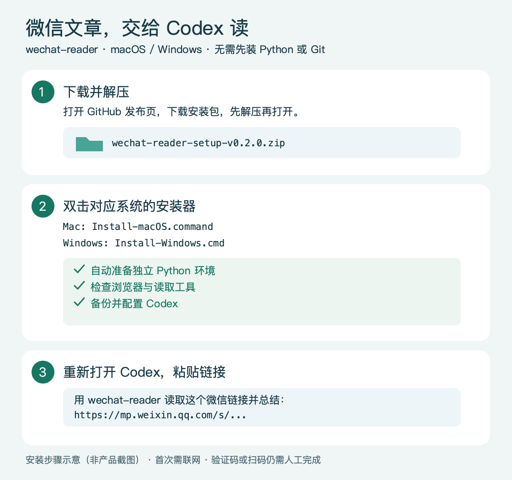

# 三步开始使用

先安装并登录 Codex 桌面应用。安装器支持 macOS 和 Windows，首次运行需要联网；无需先安装 Git 或 Python，也无需 OpenAI API Key。

## 1. 下载并解压

打开 [v0.2.0 发布页](https://github.com/yunruiguo/wechat-reader/releases/tag/v0.2.0)，下载 **wechat-reader-setup-v0.2.0.zip**，完整解压到任意文件夹。

## 2. 双击安装

| 你的电脑 | 双击这个文件 |
| --- | --- |
| macOS | `Install-macOS.command` |
| Windows | `Install-Windows.cmd` |

请按系统提示确认运行。Windows 需要先解压，不要在压缩包预览中直接打开。

安装器会自动准备独立 Python、安装依赖、检查浏览器是否能启动、验证读取工具，并配置 Codex。没有 Chrome 时，会下载工具专用的 Chromium 浏览器。首次下载可能需要几分钟。

看到 **“安装就绪”** 即完成，可以关闭安装窗口。

## 3. 在 Codex 中使用

关闭并重新打开 Codex，新建聊天，发送：

> 用 wechat-reader 读取这个微信链接并总结：https://mp.weixin.qq.com/s/你的文章ID

工具会自动尝试读取，遇到验证页时自动打开浏览器。若浏览器仍要求验证码或扫码，请手动完成。

## 遇到问题

| 情况 | 怎么处理 |
| --- | --- |
| 下载失败或网络超时 | 检查网络，再双击安装器；已下载的运行环境会复用 |
| Codex 里找不到工具 | 完全关闭并重新打开 Codex，再新建聊天 |
| Mac 提示安装器没有执行权限 | 打开“终端”，输入 `bash `（末尾有空格），把 `Install-macOS.command` 拖进去，再按回车 |
| Windows 被组织策略阻止运行 | 联系设备管理员授权运行安装器 |
| 想升级 | 下载新版安装包、解压，再次双击安装器 |

详细日志位于用户目录中的 `.wechat-reader/install.log`。Codex 原配置会在修改前备份为 `config.toml.backup-*`，其他模型、服务和权限设置会保留。若原配置格式有误，或已有同名远程服务，安装器会停止并提示，不会清空配置。

安装器把运行环境放在用户目录 `.wechat-reader` 中，使用 `CODEX_HOME/config.toml`（未设置时为 `~/.codex/config.toml`）。安装完成后可删除下载的解压文件夹。

Windows 启动器只为本次安装进程设置 PowerShell 执行方式，不更改系统执行策略。安装器使用 [uv 官方下载源](https://docs.astral.sh/uv/reference/installer/) 准备运行环境；Codex 配置格式参照 [OpenAI 官方说明](https://developers.openai.com/codex/mcp/)。
